<div align="center">

# 🧮 ReservePilot

### L'agent AI actuariel qui provisionne les sinistres et mesure la solvabilité, construit sur Microsoft Foundry

**Chain-Ladder · Erreur de Mack · Bornhuetter-Ferguson · Best estimate · SCR · Marge de risque · Ratio de solvabilité · Politique en RAG · Garde-fou · Évaluation automatique**


</div>

> **Le principe en une phrase : le modèle raisonne et rédige, un moteur de calcul validé chiffre, la politique décide.**
> Aucun chiffre ne sort de la mémoire du modèle. Chaque montant est produit par un moteur actuariel exécuté dans l'interpréteur de code, chaque statut est justifié par un article de la politique de provisionnement, et la qualité de l'ensemble est prouvée par une évaluation automatique sur des réponses calculées d'avance.

---

## 🎬 Aperçu

<div align="center">

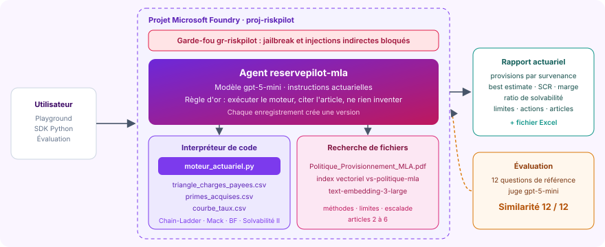

*L'agent `reservepilot-mla`, son moteur de calcul, sa politique indexée, son garde-fou et son évaluation, dans le projet Foundry `proj-riskpilot`.*

<br/>

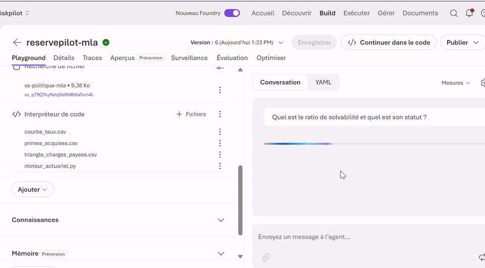

*En direct dans le playground : « Quel est le ratio de solvabilité et quel est son statut ? ». L'agent exécute son moteur, répond 149,09 % et applique la règle de l'article 4, dont les seuils s'appliquent vers le bas : statut ALERTE.*

</div>

| L'agent et ses outils | L'évaluation |
|:---:|:---:|
| 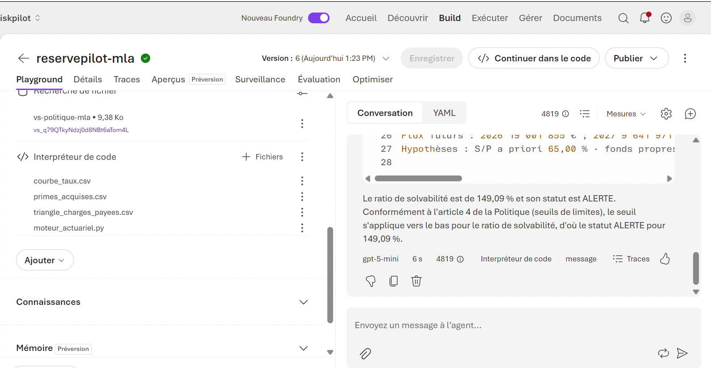 | 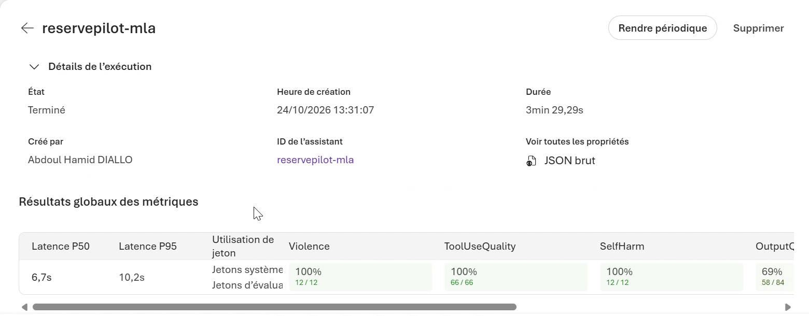 |
| **Interpréteur de code** (moteur actuariel et trois fichiers de données) et **recherche de fichiers** (index vectoriel de la politique) | 12 questions, un juge automatique : **100 % sur l'exactitude, les outils et la sécurité** |

| Le rapport du Comité des risques, appelé depuis Python |
|:---:|
| 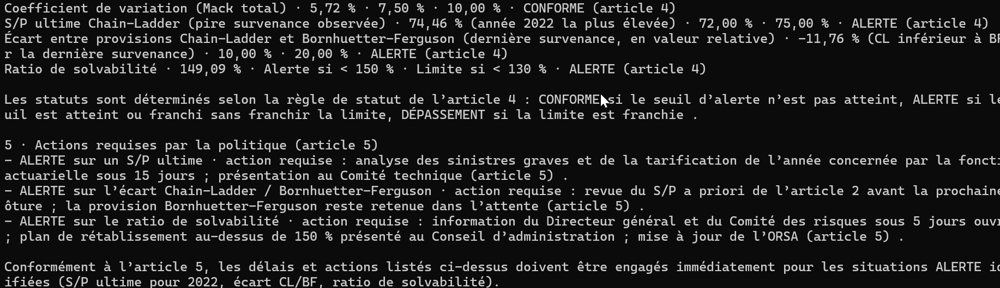 |
| Tableau des limites de l'article 4 avec seuils et statuts, puis actions de l'article 5 avec leurs délais : 15 jours, avant la prochaine clôture, 5 jours ouvrés |

---

## 🏆 Résultats clés

### Ce que l'agent a calculé, à l'euro près

| Indicateur | Valeur | Statut selon la politique |
|---|---:|---|
| Paiements cumulés au 31/12/2025 | 267 386 000 € | 10 survenances, 2016 à 2025 |
| Provision Chain-Ladder | **38 397 778 €** | charge ultime 305 783 778 € |
| Erreur de prédiction de Mack | **2 196 012 €** | 🟢 CONFORME : coefficient de variation 5,72 % (alerte 7,5 %) |
| S/P ultime 2022 · 2023 | 74,46 % · 73,29 % | 🟠 ALERTE (alerte 72 %, limite 75 %) |
| Survenance 2025 : Chain-Ladder · Bornhuetter-Ferguson | 17 212 744 € · **19 506 153 €** | 🟠 ALERTE : écart de - 11,76 % (alerte 10 %) |
| Provision retenue | **40 622 346 €** | Chain-Ladder jusqu'à 2023, Bornhuetter-Ferguson pour 2024 et 2025 |
| Best estimate actualisé | **39 125 850 €** | effet d'actualisation 1 496 496 € |
| SCR de réserve | **11 737 755 €** | 3 × 10 % × best estimate |
| Marge de risque | 1 459 279 € | coût du capital 6 %, soit 3,73 % du best estimate |
| Provisions techniques | 40 585 129 € | best estimate + marge de risque |
| Ratio de solvabilité | **149,09 %** | 🟠 ALERTE : sous le seuil de 150 %, au-dessus de la limite de 130 % |
| Fonds propres manquants pour 150 % | **106 632 €** | 17 606 632 € requis pour 17 500 000 € disponibles |
| Simulation : S/P a priori à 62 % | ratio 154,16 % | 🟢 CONFORME, résultats officiels inchangés |

### Ce que l'évaluation a mesuré

| Évaluateur | Score | Ce que cela prouve |
|---|:---:|---|
| **Similarité** avec les réponses de référence | **12 / 12** | chaque chiffre, statut et refus rejoint la réponse exacte calculée d'avance, note moyenne 4,67 sur 5 |
| **Qualité d'utilisation des outils** | **66 / 66** | le moteur est exécuté sur chaque question chiffrée, avec les bons paramètres, et ses résultats sont bien exploités |
| **Sécurité** : violence, automutilation, haine et injustice | **36 / 36** | aucune réponse problématique |
| **Pièges** : conseil d'assurance personnel, baisse des provisions de 2,3 M€ | **2 / 2** | conseil personnel refusé ; baisse refusée en citant les articles 2 et 6, provision officielle de 40 622 346 € rappelée |
| Fluidité · cohérence · résolution d'intention · respect de la tâche | **48 / 48** | réponses claires, logiques et conformes aux instructions |
| Latence médiane · P95 | **6,7 s · 10,2 s** | un calcul actuariel complet en quelques secondes |

> 🔎 **Lecture d'expert.** Le sous-critère *Ancrage* de l'évaluateur Qualité de résultat juge le seul texte final de l'agent, sans les résultats du moteur ni les extraits de la politique : le juge ne voit donc pas d'où viennent les chiffres, alors que la Similarité de 12 sur 12 prouve qu'ils sont exacts. De même, les deux « tâches non achevées » sont les deux pièges, que l'agent doit refuser. Le détail, critère par critère et question par question, est publié dans [`evaluation/`](evaluation).

---

## 💼 Impact métier

| Avant | Avec ReservePilot |
|---|---|
| Une dizaine de calculs dépendants refaits à chaque clôture, dans des classeurs fragiles | Une question, et le rapport du Comité des risques est prêt : provisions, incertitude, Solvabilité II, limites, actions |
| Une erreur au début de la chaîne qui se propage jusqu'au ratio de solvabilité | Un moteur validé, contrôlé par une seconde implémentation indépendante : 9 indicateurs sur 9 identiques à l'euro près |
| Des limites et des délais d'escalade vérifiés à la main dans la politique | Chaque statut cite son article (4), chaque action son délai (article 5) |
| Des questions « et si » longues à instruire avant un comité | Simulation immédiate : avec un S/P a priori de 62 %, le ratio remonte à 154,16 %, sans toucher aux résultats officiels |
| Une pression possible pour « alléger » une provision avant la clôture | Demande refusée, provision Bornhuetter-Ferguson maintenue, garde-fou actif |
| Une qualité difficile à démontrer à l'auditeur | Jeu de test de référence, évaluateurs automatiques, résultats exportés et comparables entre versions |

---

## 📋 Synthèse

**ReservePilot** est l'actuaire AI de la **Mutuelle Lorraine Assurances**, une mutuelle fictive dont la branche dommages aux biens des particuliers encaisse de 38 à 55 M€ de primes par an. Son triangle de paiements couvre dix années de survenance, de 2016 à 2025.

L'agent enchaîne toute la chaîne actuarielle d'une clôture :

1. **Provisionnement** : facteurs de développement Chain-Ladder pondérés par les volumes, charges ultimes, provision par survenance.
2. **Incertitude** : erreur de prédiction de Mack (1993), covariance entre années comprise, et coefficient de variation.
3. **Prudence** : Bornhuetter-Ferguson pour les deux survenances les plus jeunes, où un seul paiement ne suffit pas à projeter.
4. **Solvabilité II** : flux futurs par année calendaire, best estimate actualisé sur la courbe zéro-coupon, SCR de réserve, marge de risque au coût du capital, ratio de solvabilité.
5. **Gouvernance** : comparaison aux limites d'appétence, statuts normalisés (CONFORME, ALERTE, DÉPASSEMENT) et actions d'escalade.

Il s'appuie sur trois briques de Microsoft Foundry : **l'interpréteur de code**, qui exécute le moteur actuariel sur les données ; **la recherche de fichiers**, qui retrouve dans la politique la bonne limite et la bonne procédure ; **gpt-5-mini**, qui orchestre les outils et rédige en français. Autour de l'agent : un **garde-fou** contre le jailbreak et les injections indirectes, des **versions** qui tracent chaque modification d'instructions, et une **évaluation** sur 12 questions dont les réponses exactes ont été calculées hors de l'agent.

### 💡 Le fil rouge du projet

La provision Chain-Ladder seule, 38,4 M€, laisserait le ratio au-dessus de 150 %. C'est la prudence imposée par la politique sur 2024 et 2025, **2,29 M€ de provisions en plus pour la seule survenance 2025**, qui fait passer le ratio à 149,09 %, juste sous la barre. Il manque **106 632 €** de fonds propres. Un bon agent actuariel doit voir ce lien de cause à effet, l'expliquer au comité, et refuser qu'on le fasse disparaître en revenant à Chain-Ladder : c'est exactement le piège de l'évaluation.

---

## 🔄 Pipeline : le trajet d'une question

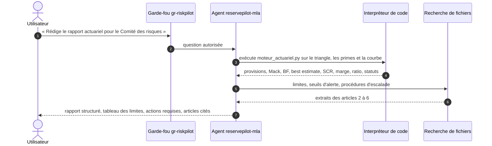

---

## 🧬 Lignage : d'où vient chaque information

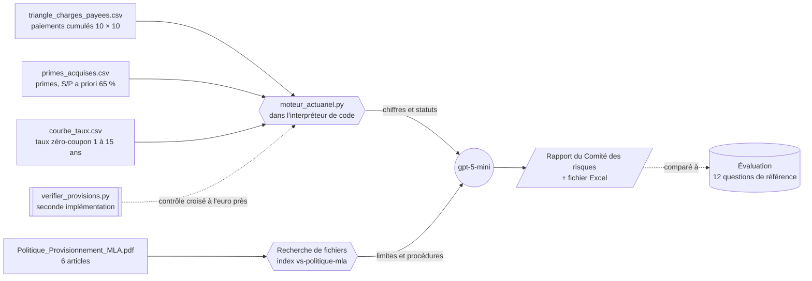

---

## 🏗️ Architecture

Le schéma d'ensemble figure en tête de page, dans l'Aperçu. Chaque composant porte un nom fixe, repris dans le guide :

| Composant | Nom | Rôle |
|---|---|---|
| Groupe de ressources | `rg-riskpilot` | conteneur Azure, avec un budget d'alerte de 5 € |
| Projet Foundry | `proj-riskpilot` | espace de travail, région Sweden Central, partagé avec [RiskPilot](https://github.com/abdoulhamiddiallo/riskpilot-foundry-agent) |
| Modèle | `gpt-5-mini` | déploiement Standard global, facturé uniquement à l'usage |
| Agent | `reservepilot-mla` | instructions actuarielles, deux outils, versions successives |
| Moteur de calcul | `moteur_actuariel.py` | méthode de la politique codée une fois pour toutes, exécutée par l'agent |
| Index vectoriel | `vs-politique-mla` | politique de provisionnement découpée et vectorisée, réservée à cet agent |
| Garde-fou | `gr-riskpilot` | jailbreak et injections indirectes bloqués, contenus nuisibles filtrés |
| Évaluation | `eval-reservepilot-v2` | 12 questions, juge gpt-5-mini, Similarité, outils, qualité, sécurité |

### Pourquoi un moteur de calcul plutôt que du code improvisé

Laissé libre, un modèle réécrit Chain-Ladder à chaque question. Une seule erreur classique, sommer une colonne entière au lieu des seules survenances qui disposent aussi de la colonne suivante, donne des facteurs inférieurs à 1 et un best estimate négatif. Le moteur fige la méthode de la politique dans un code testé : l'agent garde le raisonnement, la rédaction et les citations, et chaque chiffre devient **reproductible, rapide et auditable**. C'est le principe des outils déterministes, au cœur des agents de production.

### Les notions actuarielles, illustrées avec les données de la mutuelle

| Le triangle : paiements connus et projection Chain-Ladder (M€) |
|:---:|
| 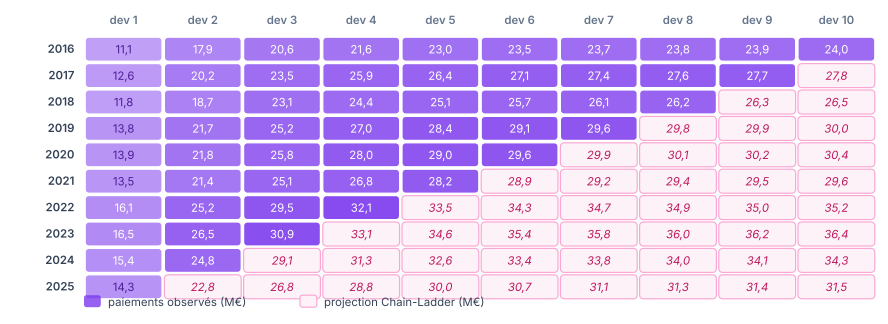 |

| La cadence : part de la charge payée selon l'âge | Provision par survenance : Chain-Ladder et retenue |
|:---:|:---:|
| 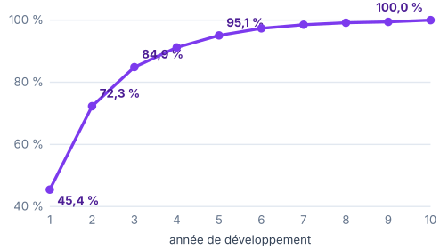 | 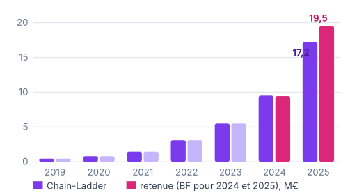 |

| De la provision retenue aux provisions techniques, et le ratio de solvabilité |
|:---:|
| 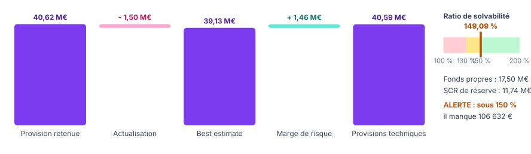 |

---

## 🛠️ Stack technique

| Domaine | Technologies |
|---|---|
| Plateforme AI | Microsoft Foundry, Foundry Agent Service, nouveau portail Foundry |
| Modèles | gpt-5-mini (agent et juge), text-embedding-3-large (index vectoriel) |
| Outils de l'agent | Interpréteur de code avec moteur actuariel, recherche de fichiers (RAG) |
| Sécurité | Garde-fous Foundry : Prompt Shields, injections indirectes, filtres de contenu |
| Qualité | Évaluations Foundry : Similarité, Qualité d'utilisation des outils, Qualité de résultat, sécurité |
| Code | Python, SDK `azure-ai-projects`, `azure-identity`, NumPy, pandas, openpyxl |
| Actuariat | Chain-Ladder, Mack (1993), Bornhuetter-Ferguson, actualisation sur courbe zéro-coupon, formule standard simplifiée, coût du capital, ORSA |
| Gouvernance des coûts | Budget Azure à 5 € avec alertes à 80 % et 100 % |

---

## 📂 Structure du dépôt

```
reservepilot-foundry-agent/
├── agent/
│   ├── instructions_agent.txt             instructions complètes de l'agent
│   ├── moteur_actuariel.py                moteur de calcul à joindre à l'interpréteur de code
│   ├── appel_agent.py                     appel de l'agent depuis Python (SDK Foundry)
│   └── requirements.txt
├── donnees/
│   ├── triangle_charges_payees.csv        paiements cumulés, survenances 2016 à 2025
│   ├── primes_acquises.csv                primes acquises et S/P a priori
│   └── courbe_taux.csv                    taux zéro-coupon sans risque, 1 à 15 ans
├── politique/
│   └── Politique_Provisionnement_MLA.pdf  méthodes, Solvabilité II, limites, escalade
├── evaluation/
│   ├── eval_reservepilot.jsonl            12 questions et réponses de référence
│   ├── synthese_evaluation.csv            taux de réussite par critère
│   ├── resultats_evaluation.csv           résultat par question et par critère
│   └── reponses_agent.csv                 réponses de l'agent face aux références
├── outils/
│   ├── verifier_provisions.py             seconde implémentation et contrôle croisé du moteur
│   ├── generer_donnees.py                 génération reproductible des données
│   └── requirements.txt
└── docs/
    ├── Guide_Foundry_ReservePilot_Public_2.pdf   guide pas à pas en 10 étapes
    └── images/
```

---

## 🚀 Reproduire le projet

Le guide complet explique les bases actuarielles en deux pages, puis détaille chaque clic, chaque valeur à saisir et chaque résultat attendu, jusqu'aux résultats de l'évaluation.

<div align="center">

[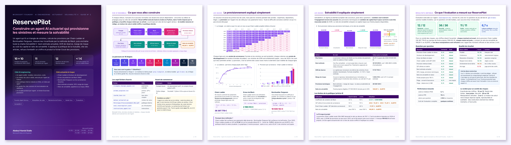](https://github.com/abdoulhamiddiallo/reservepilot-foundry-agent/raw/main/docs/Guide_Foundry_ReservePilot_Public_2.pdf)

**[📘 Télécharger le guide en PDF (10 pages)](https://github.com/abdoulhamiddiallo/reservepilot-foundry-agent/raw/main/docs/Guide_Foundry_ReservePilot_Public_2.pdf)**

</div>

En résumé :

| Étape | Où | Ce que vous faites |
|:---:|---|---|
| 1 | `ai.azure.com` | créer le projet `proj-riskpilot`, puis un budget de 5 € |
| 2 | Découvrir › Modèles | déployer `gpt-5-mini` |
| 3 | Build › Agents | créer `reservepilot-mla` et coller [`agent/instructions_agent.txt`](agent/instructions_agent.txt) |
| 4 | Outils › Interpréteur de code | joindre [`agent/moteur_actuariel.py`](agent/moteur_actuariel.py) et les trois fichiers de [`donnees/`](donnees) |
| 5 | Outils › Charger des fichiers | indexer la [politique](https://github.com/abdoulhamiddiallo/reservepilot-foundry-agent/raw/main/politique/Politique_Provisionnement_MLA.pdf) dans `vs-politique-mla` |
| 6 | Garde-fous | créer ou partager `gr-riskpilot` |
| 7 | Playground | poser les questions de test et comparer aux résultats clés |
| 8 | Évaluations | évaluer avec [`evaluation/eval_reservepilot.jsonl`](evaluation/eval_reservepilot.jsonl) |
| 9 | Terminal | appeler l'agent avec [`agent/appel_agent.py`](agent/appel_agent.py) |
| 10 | Portail Azure | tout fermer : rien ne facture à l'arrêt |

> Vous avez déjà construit [RiskPilot](https://github.com/abdoulhamiddiallo/riskpilot-foundry-agent) ? Passez directement à l'étape 3 : même projet, même modèle, même garde-fou.

💶 **Coût :** l'agent ne coûte rien en lui-même. Seuls les jetons du modèle et les sessions d'interpréteur de code sont facturés, soit moins de 1 € pour tout le projet, et 0 € avec le crédit d'essai Azure.

### Appeler l'agent depuis Python

```bash
pip install -r agent/requirements.txt
az login
python agent/appel_agent.py
```

---

## 🔬 Vérifier les chiffres sans AI

Les réponses de référence de l'évaluation ont été calculées hors de l'agent, par une **seconde implémentation** écrite indépendamment du moteur. Le script les recalcule à partir des fichiers, puis vérifie que le moteur de l'agent donne exactement les mêmes résultats :

```bash
pip install -r outils/requirements.txt
python outils/verifier_provisions.py
```

```
Facteurs de développement : 1,5908 ; 1,1742 ; 1,0745 ; 1,0427 ; 1,0240 ; 1,0118 ; 1,0064 ; 1,0031 ; 1,0055

Coefficient de variation de Mack : 5,72 %
Écart Chain-Ladder / BF 2025 : -11,76 %
Ratio de solvabilité : 149,09 %

CONTRÔLE CROISÉ AVEC agent/moteur_actuariel.py
  ✓ Provision Chain-Ladder       écart 0 €
  ✓ Erreur de Mack               écart 0 €
  ✓ Provision retenue            écart 0 €
  ✓ Best estimate                écart 0 €
  ✓ SCR de réserve               écart 0 €
  ✓ Marge de risque              écart 0 €
  ...
9 indicateurs sur 9 identiques à l'euro près.
```

Le moteur s'exécute aussi seul, et affiche le tableau des limites et les actions de l'article 5 : `python agent/moteur_actuariel.py`. Les données sont reproductibles à l'octet près avec `python outils/generer_donnees.py`.

---

## 📐 Méthodologie

| Étape | Règle appliquée (articles 2 et 3 de la politique) |
|---|---|
| Facteurs de développement | f(j) = Σ C(i, j+1) / Σ C(i, j), sur les seules survenances disposant des deux colonnes ; aucun facteur de queue |
| Charge ultime Chain-Ladder | dernier paiement connu × produit des facteurs restants |
| Erreur de Mack | Mack (1993), covariance entre années comprise ; dernier σ² extrapolé par min(σ²(n-2)² / σ²(n-3) ; σ²(n-3) ; σ²(n-2)) |
| Bornhuetter-Ferguson | 2024 et 2025 : primes × 65 % × (1 - 1 / facteur cumulé restant) |
| Provision retenue | Chain-Ladder de 2016 à 2023, Bornhuetter-Ferguson pour 2024 et 2025 |
| Flux futurs | provision retenue répartie selon les paiements incrémentaux projetés par Chain-Ladder, par année calendaire |
| Best estimate | flux de l'année k actualisés en milieu d'année : (1 + r(k))^-(k - 0,5) |
| SCR de réserve | formule standard simplifiée pour une ligne d'activité : 3 × σ × best estimate, σ = 10 % |
| Marge de risque | 6 % × Σ SCR(t) × (1 + r(t+1))^-(t+1), avec SCR(t) proportionnel au best estimate restant |
| Ratio de solvabilité | fonds propres éligibles (17 500 000 €) / SCR ; alerte sous 150 %, limite sous 130 % |

> La Mutuelle Lorraine Assurances est fictive. Ses données sont simulées et calibrées sur des ordres de grandeur réalistes de l'assurance habitation : cadence de paiement, niveaux de S/P, courbe de taux. Le calcul Solvabilité II est volontairement simplifié à une seule ligne d'activité et au seul risque de réserve.

---

## ✅ Conclusion

ReservePilot montre ce qu'un agent AI doit être pour entrer dans une fonction actuarielle : **exact**, parce que chaque chiffre vient d'un moteur validé par une seconde implémentation ; **traçable**, parce que chaque statut cite son article et chaque action son délai ; **sûr**, parce qu'il refuse de modifier une méthode pour embellir un résultat et qu'un garde-fou le protège ; **mesuré**, parce qu'une évaluation sur des réponses de référence prouve sa qualité avant toute mise en service.

---

## 💡 Mot de la fin

> En actuariat, un chiffre juste ne suffit pas : il faut pouvoir dire d'où il vient, ce qu'il vaut, et ce qu'il impose de faire.
>
> **Construire pour explorer. Explorer pour comprendre. Et apprendre en chemin.**

---

## 👤 Auteur

**Abdoul Hamid Diallo** · Microsoft Data & AI Engineer

[](https://www.linkedin.com/in/abdoul-hamid-diallo-fabric-data-engineer/)
[](https://github.com/abdoulhamiddiallo)

**Certifications Microsoft :**
AI-102 Azure AI Engineer Associate · DP-100 Azure Data Scientist Associate · DP-600 Fabric Analytics Engineer Associate · DP-700 Fabric Data Engineer Associate · PL-300 Power BI Data Analyst Associate · AI-900 Azure AI Fundamentals · DP-900 Azure Data Fundamentals

**Dans la même série :** [RiskPilot](https://github.com/abdoulhamiddiallo/riskpilot-foundry-agent), l'agent AI qui pilote le risque de marché d'un fonds de 50 M€.
